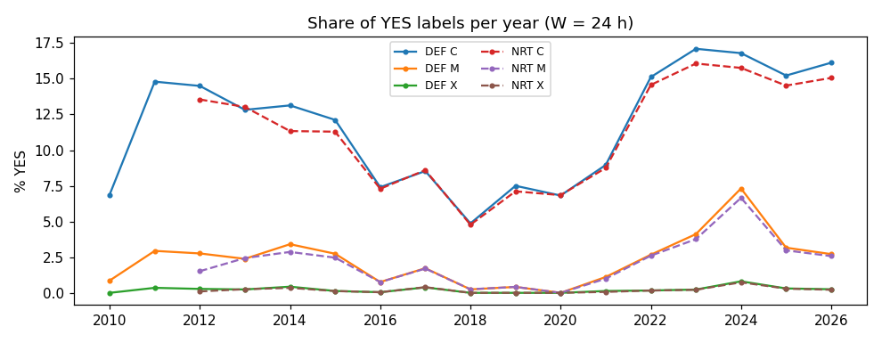

# Report notturno CORNERSTONE — 2026-11-25

## 1. Esito in breve

- **Esito: parzialmente negativo.** La pipeline principale (labeling → dataset → split → XGBoost → inferenza, riproducibilità, bundle, GUI, suite di test) funziona, ma ci sono 2 fallimenti e 3 avvertimenti.
- **25 test: ✅ 19 pass · ⚠️ 3 warn · ❌ 2 fail · ⏭️ 1 skip.**
- Problema principale: **`numba` manca nell'immagine Docker**, quindi MINIROCKET (`P6.minirocket`) e ROCKET (dentro `P6.other_models`) non si avviano. Il secondo fallimento (`P3.update`) è un timeout di rete verso la sorgente GOES; gli aggiornamenti SHARP DEF/NRT invece sono andati a buon fine.
- InceptionTime completo (`P11`) dà un TSS di test **inferiore di 0.067–0.079 rispetto al riferimento** su tutte e 4 le finestre. Il data store è fermo: l'ultimo record NRT ha 13 giorni.
- La notte è finita in tempo: è iniziata alle 20:00:08 e terminata alle 23:04:11 (circa 3 h 04 min), con scadenza alle 06:30. Nessun test è stato saltato per mancanza di tempo.

## 2. Tabella dei risultati

| | test | min | numeri chiave |
|---|---|---:|---|
| ✅ | P0.env | 0.02 | 12 CPU, 24.6 GB RAM, CUDA no, 53.9 GB liberi |
| ✅ | P2.manifest | 0.01 | 49 file, 652 MB, sha256 tutti verificati |
| ⚠️ | P2.sharp | 0.05 | DEF 5,628,153 righe (ultimo record 49 gg fa); NRT 4,746,570 righe (ultimo 13 gg fa) |
| ✅ | P2.goes | 0.00 | 33,536 eventi 2010–2026, 3,609 coppie HARP-NOAA |
| ✅ | P9.validation | 0.13 | 25/25 controlli |
| ✅ | P4.labeling | 0.51 | M+: DEF 1,541 YES/48,393; NRT 1,323 YES/43,275; 4–6 s per configurazione |
| ✅ | P4.determinism | 0.18 | identiche (43,275 righe) |
| ⏭️ | P4.legacy | 0.00 | `/data/cornerstone.sqlite` assente |
| ✅ | P5.def_xgb | 7.82 | TSS test 3h 0.594 · 6h 0.596 · 12h 0.581 · 24h 0.579; 21,325 campioni |
| ✅ | P5.nrt_xgb | 1.95 | TSS test 24h 0.672; 17,457 campioni |
| ✅ | P5.def_all22 | 4.31 | 22 feature, TSS test 24h 0.796 |
| ✅ | P7.reproduce | 7.03 | array e metriche identici (diff. max 0.0) |
| ✅ | P8.bundle | 0.07 | 6 artefatti, 962.7 MB, re-import: 6 saltati |
| ✅ | P10.gui_pages | 0.09 | 11 pagine, 0 eccezioni (box d'errore in `compare`) |
| ✅ | P1.package_tests | 0.08 | 27 test, 0 falliti |
| ✅ | P1.gui_unit | 0.06 | 44 test, 0 falliti |
| ✅ | P1.gui_integration | 2.06 | 7 test, 0 falliti |
| ✅ | P6.lstm | 18.34 | TSS test 24h 0.500 (5 epoche, 2 fold) |
| ✅ | P6.inceptiontime | 2.66 | TSS test 24h 0.506 |
| ✅ | P6.transformer | 7.72 | TSS test 24h 0.521 |
| ❌ | P6.minirocket | 0.15 | `ModuleNotFoundError`: manca `numba` |
| ❌ | P3.update | 17.86 | exit code 1: GOES `TimeoutError` |
| ⚠️ | P6.other_models | 12.03 | 10/11 modelli OK; ROCKET fallisce (`numba`) |
| ⚠️ | P11.inceptiontime_full | 100.89 | TSS test CV 3h 0.531 · 6h 0.516 · 12h 0.524 · 24h 0.498 (Δ da −0.067 a −0.079) |
| ✅ | P12.store_unchanged | 0.01 | 49 file invariati |

## 3. Cosa non funziona

### ❌ P6.minirocket — MINIROCKET non parte

Il training `trn-20261125-205314-eb40` si interrompe subito (dopo 0.15 min):

```
File "/app/scripts/nightly/campaign.py", line 550, in _train_and_infer
File "/app/scripts/nightly/campaign.py", line 137, in run_artifact
RuntimeError: trn-20261125-205314-eb40 failed: ModuleNotFoundError: MiniRocket requires package 'numba'
to be present in the python environment, but 'numba' was not found.
```

- **Causa probabile.** `sktime==0.39.0` (`docker/requirements-cornerstone.txt:11`) usa `numba` come dipendenza soft per MiniRocket/Rocket, ma `numba` non compare nei requisiti dell'immagine. Il commento in `docker/requirements-cornerstone.txt:25-26` dice che ROCKET/MINIROCKET "still need a CUDA GPU". Questo è in contrasto con `cs_gui/runner/adapters.py:49-51` e `docs/DOCKER.md:133`, secondo cui girano su CPU. Il problema attuale non riguarda la GPU: manca il pacchetto.
- **Soluzione suggerita (non applicata).** Aggiungere `numba` a `docker/requirements-cornerstone.txt`, con una versione compatibile con numpy 2.2.6, e ricostruire l'immagine.
- **Riprodurre:** `NIGHTLY_ONLY=P5.def_xgb,P6.minirocket scripts/nightly/run.sh --quick`. Serve anche P5.def_xgb, perché il test usa lo split DEF.

### ❌ P3.update — aggiornamento incrementale (log `logs/P3.update.log`)

```
HARP-NOAA map: 2,647 HARPs, 3,405 NOAA regions, 3,621 pairs
!! goes failed: TimeoutError: [Errno 110] Connection timed out
hmi.sharp_720s: 1 blocks written in 232s; store 5,647,107 records
hmi.sharp_720s_nrt: 2 blocks written in 703s; store 4,761,056 records
Update finished in 1070s with errors in ['goes']
  File "/opt/cornerstone/cornerstone/data/update.py", line 41, in update_all
RuntimeError: Update failed for: goes: TimeoutError: [Errno 110] Connection timed out
```

- **Esito per sorgente.** Su 4 sorgenti, 3 sono andate a buon fine:
  - `harp_noaa`: 3,609 → 3,621 coppie;
  - SHARP DEF: +18,954 righe;
  - SHARP NRT: +14,486 righe;
  - GOES: fallita per timeout di connessione, con 33,536 eventi invariati.
- **Come si arriva al fallimento.** `update_all` raccoglie gli errori delle singole sorgenti e alla fine solleva `RuntimeError` (`cornerstone/data/update.py:41`, dentro il container). Il test considera fail qualsiasi exit code diverso da 0 (`scripts/nightly/campaign.py:835-836`).
- **Causa probabile.** Un problema di rete o di raggiungibilità dell'endpoint NOAA/SWPC da questa macchina, non un bug del codice. Anche la quick run dello stesso giorno è fallita sullo stesso punto (`URLError: <urlopen error [Errno 110] Connection timed out>`), quindi il problema si ripresenta. Non ho trovato il sorgente del modulo GOES fuori dal container, perciò non posso indicare l'URL esatto né il timeout usato.
- **Riprodurre:** `NIGHTLY_ONLY=P3.update scripts/nightly/run.sh --quick`. In modalità quick aggiorna solo `harp_noaa,goes`, che basta per vedere l'errore.

## 4. Criticità e avvertimenti

- **⚠️ P2.sharp, store non aggiornato.**
  - Ultimo record NRT: 2026-11-11 22:11 (13 giorni). Ultimo record DEF: 2026-10-06 (49 giorni). Ultimo evento GOES: 2026-11-10 20:23.
  - P3.update conferma che alla sorgente ci sono dati nuovi (DEF +18,954, NRT +14,486, HARP-NOAA +12). Conviene aggiornare lo store dalla pagina Data.
  - DEF ha 268,247 record con patch vuota e il 4.77% di `LAT_MIN` nullo. NRT ha 0 record con patch vuota e 0% di nulli.
- **⚠️ P11.inceptiontime_full, TSS sotto il riferimento.**
  - Media CV del TSS di test: 0.531 / 0.516 / 0.524 / 0.498 (3h/6h/12h/24h), contro il riferimento 0.610 / 0.588 / 0.590 / 0.569 (`campaign.py:52`, esperimento GUI del 2026-11-12). Anche l'inferenza sul test è più bassa: 0.519 / 0.520 / 0.531 / 0.493.
  - Il training è durato 1.68 h, contro le "~6 h on CPU" della documentazione. I file non dicono se si sia fermato prima per early stopping.
  - I file non permettono di determinare la causa: non so se store e split coincidano con quelli del riferimento.
- **⚠️ P6.other_models.**
  - ROCKET fallisce per la mancanza di `numba` (vedi §3).
  - Tra i modelli che funzionano, con 1 epoca e 1 fold, **Autoformer ha un TSS di 0.0048**: in pratica una previsione casuale, ed è anche il più lento (5.6 min). Anche LightTS (0.184) e ONEFITSALL (0.240) sono bassi. Con 1 epoca può essere normale, ma va tenuto d'occhio.
- **Numeri sospetti nei test passati.**
  - `P5.def_all22`: TSS 24h di **0.796** con tutte le 22 keyword, contro 0.579 con le feature "clean". Un salto di +0.22 è grande. Conviene verificare che tra le 22 keyword non ci siano feature che introducono leakage, che è il motivo dell'esistenza della lista `CLEAN_FEATURES`.
  - `P5.nrt_xgb` (TSS 0.672) supera DEF (0.579) di quasi 0.10. Non è necessariamente un errore, ma è insolito.
  - Il TSS medio CV di validazione per XGBoost DEF è circa 0.67, contro circa 0.58 sul test: c'è un divario validazione/test di circa 0.09.
  - I modelli neurali brevi (5 epoche) hanno TSS di test tra 0.50 e 0.52, sotto XGBoost. È atteso, dato il training breve.
- **P10.gui_pages.** La pagina `compare` mostra un box d'errore ("comparison NOT valid — the evaluated samples differ…"). Probabilmente è il comportamento voluto, perché confronta training su split diversi. Nel log `logs/P10.gui_pages.log` c'è anche un `pyarrow.lib.ArrowInvalid` (colonna `trn-20261125-201524-8c88` con il valore `'["3h", "6h", "12h", "24h"]'` da convertire in int64). Streamlit lo corregge da solo, ma indica una colonna con tipi misti in una tabella della GUI.
- **Tempi.**
  - `P5.def_xgb` impiega 5.6 min nello split, contro 0.6 min per NRT.
  - `P6.lstm` richiede 18.3 min, contro 2.7 di InceptionTime e 7.7 di Transformer con la stessa configurazione.
- **Varie.**
  - Il disco libero è sceso da 55.7 GB (quick run) a 53.9 GB. Resta sufficiente, la documentazione indica 20–30 GB per notte.
  - In P2.goes: 22 eventi senza picco e 1 evento con satellite `////`.

## 5. Confronto con le notti precedenti

L'unica esecuzione precedente è `2026-11-25_quick`: stessi commit, ma in **modalità quick**. Usa meno dati (DEF 8,584 campioni contro 21,325), 1 epoca invece di 5 per i modelli neurali e solo `harp_noaa,goes` in P3. Le differenze qui sotto dipendono quindi dalla configurazione, non dal codice. Non vanno lette come regressioni.

- **Stato cambiato.** `P6.other_models` e `P11.inceptiontime_full` passano da ⏭️ (saltati in modalità quick) a ⚠️. Tutti gli altri stati sono invariati: P6.minirocket e P3.update erano già ❌, P2.sharp era già ⚠️.
- **TSS di test 24h cambiati di più di 0.03:**

| test | quick | notte | Δ |
|---|---:|---:|---:|
| P5.def_xgb | 0.631 | 0.579 | −0.052 |
| P5.nrt_xgb | 0.413 | 0.672 | +0.259 |
| P5.def_all22 | 0.704 | 0.796 | +0.092 |
| P6.lstm | 0.449 | 0.500 | +0.051 |
| P6.inceptiontime | 0.433 | 0.506 | +0.073 |
| P6.transformer | 0.561 | 0.521 | −0.040 |

- **Durate aumentate di più del 50%.** P5.def_xgb, P7.reproduce, P8.bundle, P4.labeling e i P6 neurali sono tutti più lunghi, ma è coerente con più dati ed epoche. P5.nrt_xgb invece è sceso da 11.07 a 1.95 min: nella quick run lo split NRT aveva preso 5.4 min.

## 6. Test saltati

- **P4.legacy**: `/data/cornerstone.sqlite` non è presente sulla macchina (il vecchio database è opzionale). Nessun test è stato saltato per la scadenza.

## 7. Dati e prestazioni

**Data store.** 49 file, 652 MB, sha256 verificati e invariati a fine notte (P12).

| serie | righe | HARP | primo record | ultimo record | età |
|---|---:|---:|---|---|---:|
| SHARP DEF | 5,628,153 | 8,301 | 2010-04-30 | 2026-10-06 | 49 gg |
| SHARP NRT | 4,746,570 | 10,749 | 2012-09-14 | 2026-11-11 | 13 gg |
| GOES (SWPC) | 33,536 eventi | — | 2010 | 2026-11-10 | 15 gg |

**Tempi della pipeline (min).**

| catena | labels | dataset | split | train+infer |
|---|---:|---:|---:|---:|
| DEF clean (P5.def_xgb) | 0.1 | 0.3 | 5.6 | 1.9 |
| NRT clean (P5.nrt_xgb) | 0.2 | 0.2 | 0.6 | n.d. |
| DEF all22 (P5.def_all22) | 0.1 | 0.6 | 1.0 | n.d. |

Per il labeling DEF/NRT × C/M/X servono 4.4–5.5 s per configurazione. L'export del bundle richiede 3.8 s.

**Metriche dei modelli (TSS sul test).**

| modello | configurazione | 3h | 6h | 12h | 24h |
|---|---|---:|---:|---:|---:|
| XGBoost DEF clean | 5 fold | 0.594 | 0.596 | 0.581 | 0.579 |
| XGBoost NRT clean | 5 fold | | | | 0.672 |
| XGBoost DEF all22 | 5 fold | | | | 0.796 |
| LSTM | 5 ep, 2 fold | | | | 0.500 |
| InceptionTime | 5 ep, 2 fold | | | | 0.506 |
| Transformer | 5 ep, 2 fold | | | | 0.521 |
| InceptionTime full (media CV) | 100 ep, 5 fold | 0.531 | 0.516 | 0.524 | 0.498 |
| *riferimento InceptionTime* | | *0.610* | *0.588* | *0.590* | *0.569* |

Altri modelli (1 epoca, finestra 3h): Informer 0.476, Reformer 0.469, Pyraformer 0.462, TimesNet 0.457, Nonstationary_Transformer 0.443, DLinear 0.368, FEDformer 0.339, ONEFITSALL 0.240, LightTS 0.184, Autoformer 0.005.





## 8. Ambiente

- **Commit**: package `cornerstone_db_package` `984804b` (`984804b6efabe66252da5416c6da0e0d760f4c36`, pulito); GUI `8c2362d` (`8c2362d551f9e9dc84bfce6fbae2d2e61849c761`, branch `main`, pulito).
- **Hardware**: 12 CPU, 24.6 GB di RAM, nessuna CUDA (training su CPU), 53.9 GB di disco libero.
- **Software**: Python 3.10.22, numpy 2.2.6, pandas 2.3.3, torch 2.9.1+cpu, xgboost-cpu 3.1.2, sktime 0.39.0, scikit-learn 1.7.2, h5py 3.15.1, clearml 2.0.2, cupy-cuda12x 13.6.0. `numba` è assente.
- **Build dell'immagine** (`build.json`): ok in 5 s, terminata alle 2026-11-25T20:00:07Z. Quasi tutti i layer erano in cache: è stato rifatto solo il clone del package al commit `984804b` e la copia della GUI. Nel `run.log` c'è un avviso: "Docker Compose is configured to build using Bake, but buildx isn't installed" (non bloccante).
