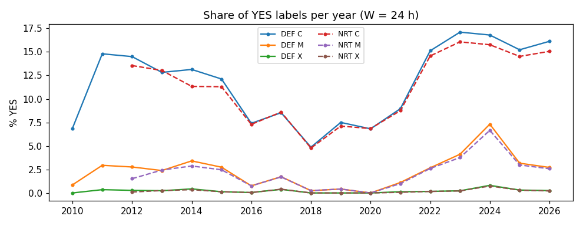

# CORNERSTONE nightly tests — 2026-11-25

Started 2026-11-25T20:00:08, last update 2026-11-25T23:04:11, deadline 2026-11-26T06:30.

✅ pass 19 · ⚠️ warn 3 · ❌ fail 2 · ⏭️ skip 1

Package `984804b`, GUI `8c2362d`; 12 CPU, 24.6 GB RAM, CUDA False, 53.9 GB free.

| | test | min | result |
|---|---|---|---|
| ✅ | **P0.env** Versions, hardware, disk, data store present | 0.02 | 12 CPU, 24.6 GB RAM, CUDA False, 54 GB free |
| ✅ | **P2.manifest** Every store file matches the sha256 of the manifest | 0.01 | 49 files, 652 MB, all verified |
| ⚠️ | **P2.sharp** SHARP DEF/NRT: rows, keys, order, missing values, freshness | 0.05 | NRT: last record 13 days ago (store not updated?) |
| ✅ | **P2.goes** GOES events and HARP-NOAA map: coverage and consistency | 0.0 | 33,536 events 2010-2026, 3,609 HARP-NOAA pairs |
| ✅ | **P9.validation** Wrong parameters are refused with a message | 0.13 | 25 checks |
| ✅ | **P4.labeling** Labels DEF/NRT × C/M/X: invariants, monotonicity, timing | 0.51 | DEF_C 6,689 YES/48,393 (5s), DEF_M 1,541 YES/48,393 (4s), DEF_X 145 YES/48,393 (5s), NRT_C 5,716 YES/43,275 (6s), NRT_M 1,323 YES/43,275 (6s), NRT_X 121 YES/43,275 (5s) |
| ✅ | **P4.determinism** Labeling twice with the same parameters gives identical labels | 0.18 | identical (43,275 rows); S_s = C, L = 48 h invariants hold |
| ⏭️ | **P4.legacy** Comparison with the static tables of the former database | 0.0 | /data/cornerstone.sqlite not present on this machine (the former database is optional) |
| ✅ | **P5.def_xgb** DEF M+ 24 h: labels → dataset → split → XGBoost → inference | 7.82 | test TSS {'3h': 0.5942, '6h': 0.5964, '12h': 0.5811, '24h': 0.5793}; 21,325 samples |
| ✅ | **P5.nrt_xgb** NRT M+ 24 h: same chain on the NRT series | 1.95 | test TSS {'24h': 0.6721}; 17,457 samples |
| ✅ | **P5.def_all22** DEF with all 22 SHARP keywords (features 'all') + XGBoost | 4.31 | 22 features, test TSS {'24h': 0.7962} |
| ✅ | **P7.reproduce** Re-running dataset and XGBoost training gives identical results | 7.03 | dataset and XGBoost metrics identical |
| ✅ | **P8.bundle** Export the DEF chain as a bundle and import it into an empty workspace | 0.07 | 6 artifacts, 962.7 MB, re-import skipped 6 |
| ✅ | **P10.gui_pages** Every GUI page renders without exceptions (Streamlit AppTest) | 0.09 | 11 pages, no exceptions; error boxes shown by ['compare'] (see details) |
| ✅ | **P1.package_tests** Package unit tests (cornerstone_db_package/tests) | 0.08 | 27 tests, 0 failed, 0 skipped |
| ✅ | **P1.gui_unit** GUI unit tests | 0.06 | 44 tests, 0 failed, 0 skipped |
| ✅ | **P1.gui_integration** GUI integration tests (whole chain on synthetic data) | 2.06 | 7 tests, 0 failed, 0 skipped |
| ✅ | **P6.lstm** LSTM: short training + inference on the DEF split | 18.34 | completed in 18.3 min (5 epochs, 2 folds), test TSS {'24h': 0.5002} |
| ✅ | **P6.inceptiontime** INCEPTIONTIME: short training + inference on the DEF split | 2.66 | completed in 2.7 min (5 epochs, 2 folds), test TSS {'24h': 0.5063} |
| ✅ | **P6.transformer** TRANSFORMER: short training + inference on the DEF split | 7.72 | completed in 7.7 min (5 epochs, 2 folds), test TSS {'24h': 0.5213} |
| ❌ | **P6.minirocket** MINIROCKET: short training + inference on the DEF split | 0.15 | RuntimeError: trn-20261125-205314-eb40 failed: ModuleNotFoundError: MiniRocket requires package 'numba' to be present in the python environment, but 'numba' was not found. 'numba' is a dependency of MiniRocket and required to construct it. To install the requirement 'numba', please run: `pip install numba`  |
| ❌ | **P3.update** Incremental update from JSOC/NOAA on a copy of the store | 17.86 | update exited with code 1 after 17.9 min (see the log) |
| ⚠️ | **P6.other_models** Other models offered by the GUI: 1 epoch, 1 fold, 3 h window | 12.03 | working: ['ONEFITSALL', 'Autoformer', 'DLinear', 'FEDformer', 'LightTS', 'Nonstationary_Transformer', 'Pyraformer', 'Reformer', 'TimesNet', 'Informer']; failing: ['ROCKET'] |
| ⚠️ | **P11.inceptiontime_full** InceptionTime as the reference experiment (4 windows, 5 folds, 100 epochs) | 100.89 | test TSS differs from the reference by more than 0.05: {'12h': -0.067, '24h': -0.071, '3h': -0.079, '6h': -0.072} |
| ✅ | **P12.store_unchanged** The tests did not modify the data store | 0.01 | 49 files unchanged |

## Figures

