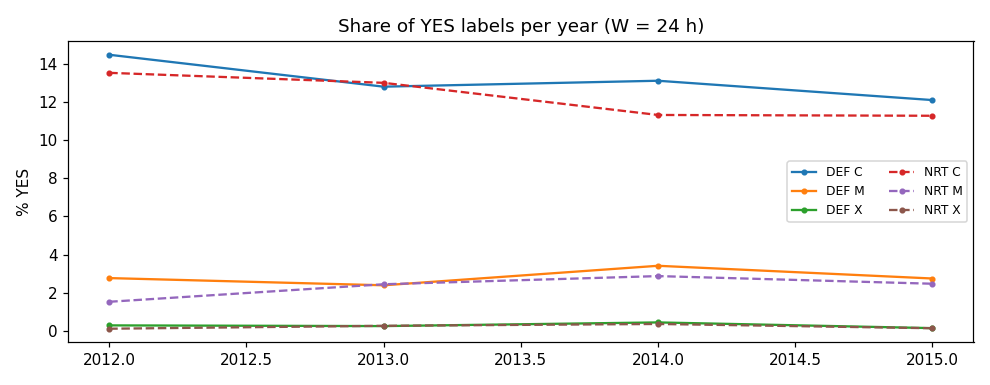

# CORNERSTONE — report della campagna notturna 2026-11-25_quick

## 1. Esito in breve

- **Esito: parzialmente positivo.** 25 test: ✅ 19 superati · ⚠️ 1 avvertimento · ❌ 2 falliti · ⏭️ 3 saltati.
- La catena principale (labels → dataset → split → XGBoost → inference) funziona su DEF e NRT ed è riproducibile (`P7.reproduce`: differenza 0.0). Le suite di test di package e GUI passano tutte (27 + 44 + 7 test).
- **Problema principale:** `P6.minirocket` fallisce perché nell'immagine Docker manca `numba`. Non è installato da nessun file requirements.
- `P3.update` fallisce per un timeout di rete verso la sorgente GOES. Il data store è vecchio: l'ultimo record NRT risale a 13 giorni prima.
- Campagna in modalità `--quick`, eseguita dalle 16:20:50 alle 17:05:29 (circa 45 min). È finita molto prima della scadenza (2026-11-26 07:30) e nessun test è stato saltato per la scadenza.

## 2. Tabella dei risultati

| | test | min | numeri chiave |
|---|---|---|---|
| ✅ | P0.env | 0.02 | 12 CPU, 24.6 GB RAM, CUDA False, 55.7 GB liberi |
| ✅ | P2.manifest | 0.01 | 49 file, 652 MB, sha256 tutti verificati |
| ⚠️ | P2.sharp | 0.06 | DEF 5,628,153 righe (ultimo record 49 gg prima); NRT 4,746,570 righe (**13 gg**) |
| ✅ | P2.goes | 0.00 | 33,536 eventi 2010–2026, 3,609 coppie HARP-NOAA, ultimo evento 2026-11-10 |
| ✅ | P9.validation | 0.14 | 25/25 controlli |
| ✅ | P4.labeling | 0.27 | M+: DEF 454 YES/16,014, NRT 340 YES/13,474; 0 violazioni; 2–3 s per configurazione |
| ✅ | P4.determinism | 0.10 | 13,474 righe identiche |
| ⏭️ | P4.legacy | 0.00 | `/data/cornerstone.sqlite` assente |
| ✅ | P5.def_xgb | 1.25 | test TSS 24h **0.631** (CV val 0.663); 8,584 campioni, 523 positivi |
| ✅ | P5.nrt_xgb | 11.07 | test TSS 24h **0.413**; 4,281 campioni, 228 positivi |
| ✅ | P5.def_all22 | 6.81 | 22 feature, test TSS 24h **0.704** (contro 0.631 con le feature "clean") |
| ✅ | P7.reproduce | 0.61 | array del dataset identici, differenza massima delle metriche 0.0 |
| ✅ | P8.bundle | 0.03 | 6 artefatti, 384.5 MB; reimport: 6 saltati; import demo rifiutato |
| ✅ | P10.gui_pages | 0.09 | 11 pagine, 0 eccezioni; box di errore in `compare` |
| ✅ | P1.package_tests | 0.08 | 27 test, 0 falliti |
| ✅ | P1.gui_unit | 0.06 | 44 test, 0 falliti |
| ✅ | P1.gui_integration | 2.07 | 7 test, 0 falliti (122.7 s) |
| ✅ | P6.lstm | 2.15 | 1 epoca, 2 fold: test TSS 24h 0.449 |
| ✅ | P6.inceptiontime | 0.65 | 1 epoca, 2 fold: test TSS 24h 0.433 |
| ✅ | P6.transformer | 1.10 | 1 epoca, 2 fold: test TSS 24h 0.561 |
| ❌ | P6.minirocket | 0.15 | `ModuleNotFoundError`: manca `numba` |
| ❌ | P3.update | 17.92 | exit code 1: GOES `URLError … [Errno 110] Connection timed out` |
| ⏭️ | P6.other_models | 0.00 | non eseguito in modalità quick |
| ⏭️ | P11.inceptiontime_full | 0.00 | non eseguito in modalità quick |
| ✅ | P12.store_unchanged | 0.01 | 49 file invariati |

## 3. Cosa non funziona

### ❌ P6.minirocket — manca `numba`

Il training `trn-20261125-164725-f294` fallisce subito (0.15 min). Il test non ha un file di log proprio; questo è il traceback da `results.json`:

```
File "/app/scripts/nightly/campaign.py", line 769, in t
  tr, inf = _train_and_infer(c, f"DEF-short", ch["sp"], model, {}, ...
File "/app/scripts/nightly/campaign.py", line 550, in _train_and_infer
  tr = c.run_artifact(c.pl.create_training(...
File "/app/scripts/nightly/campaign.py", line 137, in run_artifact
RuntimeError: trn-20261125-164725-f294 failed: ModuleNotFoundError: MiniRocket requires package
'numba' to be present in the python environment, but 'numba' was not found.
```

**Causa probabile:**
- In sktime, `numba` è una dipendenza "soft" di MiniRocket/Rocket.
- `numba` non compare in `docker/requirements-cornerstone.txt` né in nessun altro file del repo GUI (ho cercato "numba" in tutto il repo: zero risultati).
- Il commento in `docker/requirements-cornerstone.txt:25-26` dice che ROCKET/MINIROCKET "still need a CUDA GPU". Questo contraddice `cs_gui/runner/adapters.py:50`, `docs/ARCHITECTURE.md:32` e `docs/DOCKER.md:133`, secondo cui calcolano su CPU.

**Correzione suggerita:** aggiungere `numba` con versione fissata (compatibile con numpy 2.2.6) a `docker/requirements-cornerstone.txt`, poi correggere il commento. Lo stesso problema colpisce anche ROCKET; vedi la sezione 5.

**Riproduzione:** il test ha bisogno della catena DEF.

```
NIGHTLY_ONLY=P5.def_xgb,P6.minirocket scripts/nightly/run.sh --quick
```

### ❌ P3.update — timeout di rete su GOES

`logs/P3.update.log`:

```
HARP-NOAA map: 2,647 HARPs, 3,405 NOAA regions, 3,621 pairs
!! goes failed: URLError: <urlopen error [Errno 110] Connection timed out>
Update finished in 1074s with errors in ['goes']
  File "/opt/cornerstone/cornerstone/data/update.py", line 41, in update_all
RuntimeError: Update failed for: goes: URLError: <urlopen error [Errno 110] Connection timed out>
```

**Cosa ha funzionato:** in modalità quick le sorgenti sono solo `harp_noaa,goes` (`campaign.py:822`). La parte HARP-NOAA ha funzionato: le coppie sono passate da 3,609 a 3,621. Gli eventi GOES sono rimasti 33,536.

**Causa probabile:** non è un errore di logica ma un errore di rete (errno 110) verso il server NOAA/SWPC. `update.py:41` raccoglie gli errori e rilancia l'eccezione alla fine, come previsto.

**Punto da verificare:** 1074 s per un aggiornamento che non scarica SHARP sono sospetti. Probabilmente la maggior parte del tempo è stata spesa in attesa della connessione GOES (timeout lungo o tentativi ripetuti). Non posso verificarlo: il sorgente del package (`/opt/cornerstone`) esiste solo dentro l'immagine e non è su questa macchina.

**Riproduzione:**
```
NIGHTLY_ONLY=P3.update scripts/nightly/run.sh --quick
```
Per isolare GOES:
```
python -c "from cornerstone.data import DataStore; from cornerstone.data.update import update_all; update_all(DataStore('<copia>'), sources=['goes'])"
```
da eseguire su una copia dello store.

## 4. Criticità e avvertimenti

- **⚠️ P2.sharp — store non aggiornato.**
  - NRT: ultimo record 2026-11-11 22:11, cioè 13 giorni prima (la soglia è 7).
  - DEF: ultimo record 2026-10-06, cioè 49 giorni prima (soglia 90).
  - GOES: ultimo evento 2026-11-10, appena sotto la soglia di 14 giorni (`campaign.py:346`). Dalla prossima notte `P2.goes` passerà probabilmente a warn.
  - Con `P3.update` fallito, lo store va aggiornato a mano.
- **TSS NRT molto più basso di DEF** (0.413 contro 0.631). Il campione quick è piccolo (4,281 campioni, 228 positivi) e ha più NaN (nan_ratio 0.318 contro 0.213). Nella run completa successiva lo stesso test dà 0.672 (vedi sezione 5), quindi è probabilmente un effetto del campione ridotto.
- **`P5.def_all22` ottiene +0.073 TSS rispetto alle 17 feature "clean"** (0.704 contro 0.631). Conviene verificare che le 5 keyword in più non portino informazione indebita, ad esempio feature legate alla dimensione della patch o a `LAT_MIN` con valori mancanti.
- **Split lenti in modo irregolare.** Lo split DEF richiede 0.5 min, ma quello NRT 5.4 min e quello all22 5.6 min. NRT ha la metà dei campioni di DEF, quindi la durata non dipende dalla dimensione. Ne deriva la durata di `P5.nrt_xgb`: 11.07 min contro 10 stimati.
- **Valori mancanti in DEF:** `LAT_MIN` è nullo nel 4.77% dei record e ci sono 268,247 record con patch vuota; NRT ne ha 0.
- **Associazione eventi ↔ regioni:** NRT ha 4,708 eventi non associati contro 1,114 di DEF.
- **GOES:** 22 eventi senza picco, 5 eventi con satellite `SDO` e 1 con satellite `////`, valori anomali da controllare.
- **P10.gui_pages:** la pagina `compare` mostra un box di errore ("comparison NOT valid — the evaluated samples differ; different inference sources; different splits"). Non ci sono eccezioni. Sembra un messaggio di validazione legittimo, perché il workspace contiene artefatti su split diversi, ma il test lo segnala.
- **Modelli neurali:** i TSS tra 0.43 e 0.56 dopo 1 epoca sono attesi per un test di funzionamento, non di prestazioni.
- **Build:** `run.log` riporta un warning di Docker Compose ("configured to build using Bake, but buildx isn't installed"). Non blocca la build.
- **Documentazione:** il commento GPU in `docker/requirements-cornerstone.txt:25-26` è in contraddizione con il resto della documentazione (vedi sezione 3).

## 5. Confronto con le notti precedenti

**Non esiste una notte precedente.** L'unica altra cartella, `2026-11-25`, contiene una run **completa** iniziata più tardi (20:00–23:04) con gli stessi commit, quindi non serve a individuare regressioni. Inoltre, quick e completa usano intervalli di tempo, epoche e finestre diversi: le differenze di TSS e di durata non sono confrontabili. Dalla run successiva si ricava comunque quanto segue:

- Ha ottenuto gli stessi due fallimenti (`P6.minirocket` per `numba`, `P3.update` per il timeout GOES) e lo stesso warn su `P2.sharp`. I problemi sono quindi riproducibili e non dipendono dal caso.
- `P6.other_models` (warn): fallisce anche **ROCKET**, sempre per `numba`.
- `P11.inceptiontime_full` (warn): test TSS sotto il riferimento di 0.067–0.079 per tutte le finestre.
- `P3.update` completo ha aggiunto SHARP (DEF +18,954 righe, NRT +14,486) ma ha fallito ancora su GOES (`TimeoutError`).
- TSS sullo stesso test, quick → completa: `P5.nrt_xgb` 0.413 → 0.672; `P5.def_xgb` 0.631 → 0.579 (24h); `P5.def_all22` 0.704 → 0.796.
- Durata degli split: DEF 0.5 → 5.6 min, NRT 5.4 → 0.6 min. Anche questo indica che la lentezza dipende da qualcosa di diverso dalla dimensione del dataset, forse dal primo split della sessione o da una cache; la causa non si ricava dai file.

## 6. Test saltati

| test | motivo |
|---|---|
| P4.legacy | input mancante: `/data/cornerstone.sqlite` (il database precedente è opzionale) |
| P6.other_models | non eseguito in modalità quick (`campaign.py:788`) |
| P11.inceptiontime_full | non eseguito in modalità quick (`campaign.py:848`) |

Nessun test è stato saltato per la scadenza.

## 7. Dati e prestazioni

**Data store** (`/data/datastore`): 49 file, 652 MB, manifest integro e invariato dopo i test (`P12`).

| dataset | righe | HARP | periodo |
|---|---|---|---|
| sharp/DEF | 5,628,153 | 8,301 (max 15222) | 2010-04-30 → 2026-10-06 |
| sharp/NRT | 4,746,570 | 10,749 (max 14198) | 2012-09-14 → 2026-11-11 |
| goes/swpc_events | 33,536 (M 2,760, X 155) | — | 2010 → 2026-11-10 |
| harp_noaa | 3,609 coppie | — | — |

**Tempi della pipeline** (min, dati quick 2011–2015):

| catena | labels | dataset | split | training+inference | totale test |
|---|---|---|---|---|---|
| DEF clean (P5.def_xgb) | 0.1 | 0.1 | 0.5 | 0.6 | 1.25 |
| NRT (P5.nrt_xgb) | 0.1 | 0.1 | 5.4 | n.d. | 11.07 |
| DEF all22 (P5.def_all22) | 0.1 | 0.2 | 5.6 | n.d. | 6.81 |

Altri tempi:
- labeling (P4): 2.2–3.0 s per configurazione;
- integrazione GUI: 122.7 s;
- export del bundle: 1.6 s;
- update (fallito): 17.9 min.

**Metriche dei modelli** (M+, finestra 24h, split DEF salvo indicazione):

| modello | config | CV val TSS | test TSS |
|---|---|---|---|
| XGBoost (DEF clean, 17 feat.) | 30 alberi, 5 fold | 0.663 | 0.631 |
| XGBoost (NRT) | 30 alberi, 5 fold | n.d. | 0.413 |
| XGBoost (DEF all, 22 feat.) | 30 alberi, 5 fold | n.d. | 0.704 |
| LSTM | 1 epoca, 2 fold | 0.482 | 0.449 |
| InceptionTime | 1 epoca, 2 fold | 0.488 | 0.433 |
| Transformer | 1 epoca, 2 fold | 0.571 | 0.561 |
| MiniRocket | — | fallito | fallito |

Split DEF: 7,396 campioni tenuti, 1,188 esclusi. Nessun leakage: 0 HARP condivisi tra test e train/val, 0 HARP condivisi tra train e val in ciascuno dei 5 fold.




## 8. Ambiente

- **Package** `cornerstone_db_package`: commit `984804b6efabe66252da5416c6da0e0d760f4c36` (main, pulito).
- **GUI** `cornerstone_gui`: commit `8c2362d551f9e9dc84bfce6fbae2d2e61849c761` (main, pulito).
- **Hardware:** Python 3.10.22; 12 CPU, 24.6 GB RAM, **nessuna GPU** (CUDA False, torch 2.9.1+cpu); disco libero 55.7 GB. È sufficiente: secondo la documentazione una notte completa richiede 20–30 GB.
- **Librerie principali:** numpy 2.2.6, pandas 2.3.3, scikit-learn 1.7.2, xgboost-cpu 3.1.2, sktime 0.39.0, h5py 3.15.1, clearml 2.0.2, cupy-cuda12x 13.6.0. `numba` non c'è.
- **Build dell'immagine** (`build.json`): ok in 4 s, terminata alle 16:20:48 UTC. Quasi tutti i layer venivano dalla cache; il package è stato preso da GitHub `main` @ `984804b`. C'è un warning sull'assenza di buildx (vedi sezione 4).
