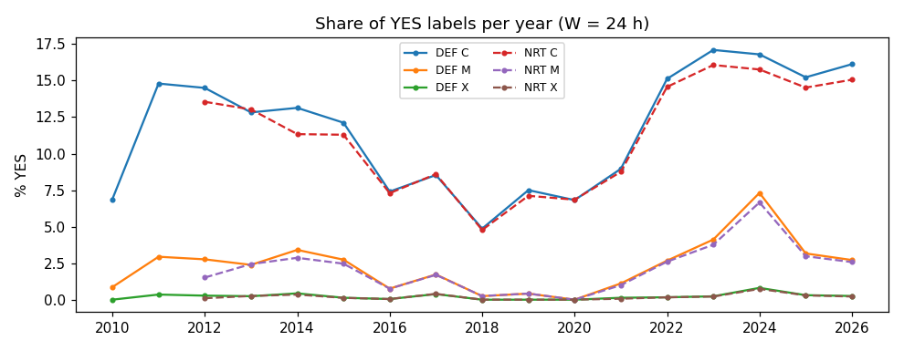

# CORNERSTONE — report della notte 2026-11-26

## 1. Esito in breve

- **Esito: complessivamente buono, con un problema persistente.** 25 test: ✅ 20 pass · ⚠️ 3 warn · ❌ 1 fail · ⏭️ 1 skip.
- L'unico fallimento è **P3.update**: il download degli eventi GOES va in timeout (`TimeoutError: [Errno 110] Connection timed out`). SHARP DEF/NRT e la mappa HARP-NOAA invece si aggiornano. È la stessa causa della notte precedente: il data store resta fermo (ultimo evento GOES 2026-11-10, ultimo record NRT 2026-11-11).
- Novità positive rispetto al 2026-11-25: MINIROCKET e ROCKET ora funzionano (prima mancava `numba`). Le metriche dei modelli sono identiche.
- InceptionTime completo (P11) resta circa 0,07 TSS sotto il riferimento: stesso scarto della notte precedente.
- La campagna è finita alle **22:51:18**, con largo anticipo sulla scadenza delle 06:30 (exit code 0).

## 2. Tabella dei risultati

| | test | durata (min) | valori chiave |
|---|---|---|---|
| ✅ | P0.env | 0.02 | 12 CPU, 24.6 GB RAM, CUDA False, 41.8 GB liberi |
| ✅ | P2.manifest | 0.01 | 49 file, 652 MB, sha256 tutti verificati |
| ⚠️ | P2.sharp | 0.05 | DEF 5,628,153 righe (ultimo record 50 gg fa), NRT 4,746,570 righe (ultimo record **14 gg fa**) |
| ⚠️ | P2.goes | 0.00 | 33,536 eventi, ultimo evento **2026-11-10** (15 gg fa), 3,609 coppie HARP-NOAA |
| ✅ | P9.validation | 0.13 | 25/25 controlli |
| ✅ | P4.labeling | 0.50 | DEF M: 1,541 YES/48,393; NRT M: 1,323 YES/43,275; 4–6 s per etichettatura; 0 violazioni |
| ✅ | P4.determinism | 0.18 | identiche (43,275 righe) |
| ⏭️ | P4.legacy | 0.00 | `/data/cornerstone.sqlite` assente |
| ✅ | P5.def_xgb | 2.81 | test TSS 3h 0.5942 · 6h 0.5964 · 12h 0.5811 · 24h 0.5793; 21,325 campioni; 0 HARP condivise |
| ✅ | P5.nrt_xgb | 1.95 | test TSS 24h 0.6721; 17,457 campioni |
| ✅ | P5.def_all22 | 4.31 | 22 feature, test TSS 24h **0.7962** |
| ✅ | P7.reproduce | 2.02 | dataset e metriche identici (diff. max 0.0) |
| ✅ | P8.bundle | 0.07 | 6 artefatti, 962.7 MB, export+import in 4.1 s |
| ✅ | P10.gui_pages | 0.10 | 11 pagine, 0 eccezioni; riquadro d'errore su `compare` |
| ✅ | P1.package_tests | 0.30 | 27 test, 0 falliti |
| ✅ | P1.gui_unit | 0.09 | 236 test, 0 falliti |
| ✅ | P1.gui_integration | 2.05 | 7 test, 0 falliti (121.7 s) |
| ✅ | P6.lstm | 18.09 | test TSS 24h 0.5002 (5 epoche, 2 fold) |
| ✅ | P6.inceptiontime | 2.71 | test TSS 24h 0.5063 |
| ✅ | P6.transformer | 7.82 | test TSS 24h 0.5213 |
| ✅ | P6.minirocket | 2.81 | test TSS 24h **0.2718** |
| ❌ | P3.update | 10.40 | exit code 1: timeout GOES; DEF +19,991, NRT +15,216, harp_noaa +13, GOES +0 righe |
| ✅ | P6.other_models | 14.74 | 11/11 modelli funzionanti |
| ⚠️ | P11.inceptiontime_full | 99.95 | CV test TSS 3h 0.531 · 6h 0.5164 · 12h 0.5235 · 24h 0.4979 (Δ da −0.067 a −0.079 sul riferimento) |
| ✅ | P12.store_unchanged | 0.01 | 49 file invariati |

## 3. Cosa non funziona

### ❌ P3.update — l'aggiornamento incrementale fallisce sulla sorgente GOES

Righe rilevanti di `logs/P3.update.log`:

```
HARP-NOAA map: 2,648 HARPs, 3,406 NOAA regions, 3,622 pairs
!! goes failed: TimeoutError: [Errno 110] Connection timed out
hmi.sharp_720s: 1 blocks written in 119s; store 5,648,144 records
hmi.sharp_720s_nrt: 2 blocks written in 366s; store 4,761,786 records
Update finished in 623s with errors in ['goes']
  File "/opt/cornerstone/cornerstone/data/update.py", line 41, in update_all
    raise RuntimeError("Update failed for: " + "; ".join(f"{k}: {v}" for k, v in errors.items()))
RuntimeError: Update failed for: goes: TimeoutError: [Errno 110] Connection timed out
```

- **Cosa succede:** `update_all` raccoglie gli errori di ogni sorgente e alla fine li rilancia (`cornerstone/data/update.py:41` nel package, commit `984804b`). L'eccezione nasce nel download GOES/SWPC ed è un timeout di connessione TCP. JSOC (SHARP) e la mappa HARP-NOAA scaricano regolarmente, quindi la rete del container funziona. Il problema riguarda solo l'host o l'endpoint degli eventi GOES.
- **Causa probabile:** l'endpoint NOAA/SWPC usato per gli eventi GOES non è raggiungibile dal container: è giù, è cambiato URL, oppure un firewall o proxy lo blocca. Il sorgente del package non è presente su questa macchina (solo dentro l'immagine, in `/opt/cornerstone`), quindi non ho potuto verificare quale URL venga usato né il timeout impostato. Il test che invoca l'aggiornamento è in `scripts/nightly/campaign.py:813-840`.
- **Persistenza:** stesso errore in 2026-11-25 (full), 2026-11-26_quick e stanotte. Non è un problema occasionale.
- **Conseguenza:** il data store reale non viene aggiornato, da cui i warn di P2.sharp e P2.goes. Sulla copia mancano almeno +19,991 righe DEF, +15,216 NRT e +13 coppie HARP-NOAA disponibili alla fonte.
- **Riproduzione:** `NIGHTLY_ONLY=P3.update scripts/nightly/run.sh --quick`. In quick aggiorna solo `harp_noaa,goes` e riproduce l'errore in circa 2 min, come nella run 2026-11-26_quick. In alternativa, dentro il container, su una copia dello store: `python -c "from cornerstone.data import DataStore; from cornerstone.data.update import update_all; update_all(DataStore('/percorso/copia'), sources=['goes'])"`.

## 4. Criticità e avvertimenti

- **⚠️ P2.sharp / ⚠️ P2.goes — store non aggiornato.** NRT ha l'ultimo record al 2026-11-11 22:11 (14 giorni; soglia 7) e GOES l'ultimo evento al 2026-11-10 20:23 (15 giorni; soglia 14, `campaign.py:346`). P2.goes è passato da pass a warn solo perché ieri il ritardo era 14 giorni e oggi ha superato la soglia: i dati sono identici. Il ritardo di DEF (50 giorni) è sotto la soglia di 90. Si risolve aggiornando lo store dopo aver sistemato GOES (sezione 3).
- **⚠️ P11.inceptiontime_full — sotto il riferimento.** Il CV test TSS è più basso del riferimento (`campaign.py:52`: 0.610/0.588/0.590/0.569) di 0.067–0.079 su tutte le finestre. I valori sono identici al 2026-11-25, quindi il risultato è deterministico e non è una regressione di stanotte. O il riferimento non corrisponde più alla pipeline attuale, o c'è una differenza sistematica di configurazione o dati. L'addestramento è durato 1.66 h contro le ~6 h previste dal piano: è possibile un early stopping, ma dai file non si può stabilire.
- **P5.def_all22: TSS 0.7962, molto sopra gli altri.** Il modello con le 17 feature "pulite" fa 0.5793 a 24h, quindi lo scarto è di +0.22. Usa un proprio dataset e split (`DEF-all`, `campaign.py:623`) e non è direttamente confrontabile. Il salto è però sospetto: vale la pena verificare che nessuna delle 5 keyword aggiuntive veicoli informazione sull'etichetta (leakage).
- **TSS bassi tra i modelli brevi.** MINIROCKET 0.2718 (val 0.3797) è nettamente sotto LSTM, InceptionTime e Transformer (0.50–0.52). In P6.other_models, Autoformer 0.0048 e ROCKET 0.0457 sono praticamente casuali. Con 1 epoca, 1 fold e finestra 3h si tratta solo di smoke test, ma i valori vicini a 0 vanno tenuti d'occhio.
- **Durata anomala di LightTS:** 5.5 min contro 0.5 min la notte prima e 0.5–0.7 min degli altri modelli. Viceversa Autoformer è sceso da 5.6 a 0.6 min. Potrebbe trattarsi di contesa per la CPU, ma dai file non si può stabilire.
- **P10.gui_pages:** nessuna eccezione. La pagina `compare` mostra però un riquadro d'errore ("comparison NOT valid — the evaluated samples differ…"), presente anche il 2026-11-25. Inoltre il log contiene un `pyarrow.lib.ArrowInvalid` ("Could not convert '["3h", "6h", "12h", "24h"]' … column trn-20261126-201025-28da"): Streamlit lo ha corretto automaticamente, ma indica una colonna con tipi misti in una tabella di confronto dei training.
- **Spazio disco in calo:** 55.7 GB liberi (25/11 16:20) → 53.9 (25/11 20:00) → 43.6 (26/11 16:43) → 41.8 GB (26/11 20:00), cioè circa −14 GB in un giorno. Questa cartella di run occupa 5.3 GB (`workspace/`) più 526 MB (`.cache/`). La causa del resto del calo non è determinabile dai file. Oggi `df` riporta 39 GB liberi (80% usato).
- **Dati GOES:** 22 eventi senza picco (`missing_peak`), 5 eventi con satellite `SDO` e 1 con satellite `////`. Sono invariati rispetto a ieri ma meritano un controllo. Nel DEF, `LAT_MIN` è nullo nel 4.77% delle righe e ci sono 268,247 record a patch vuota (NRT: 0).
- **P1.package_tests** è passato da 3.8 s a 17.1 s. Nel junit di stanotte `test_bootstrap_from_legacy_sqlite` da solo occupa 13.4 s. Per la notte precedente non c'è il junit, quindi non posso attribuire l'aumento con certezza.

## 5. Confronto con le notti precedenti

Il riferimento principale è la run completa **2026-11-25**: stesso package `984804b`, GUI `8c2362d` → `871c1a2`. Le run `_quick` hanno parametri ridotti e servono solo per gli stati.

| test | 2026-11-25 | 2026-11-26 | nota |
|---|---|---|---|
| P6.minirocket | ❌ (`numba` mancante) | ✅ | risolto |
| P6.other_models | ⚠️ (ROCKET: `numba` mancante) | ✅ | risolto |
| P2.goes | ✅ | ⚠️ | stessi dati; il ritardo ha superato i 14 giorni |
| P3.update | ❌ | ❌ | stesso timeout GOES (anche in 2026-11-26_quick) |
| P1.gui_unit | 44 test | 236 test | suite ampliata, tutti pass |

- **Metriche:** nessuna variazione oltre 0.03 TSS. Tutti i TSS (P5, P6, P11) sono identici al 2026-11-25 fino alla quarta cifra decimale.
- **Durate cresciute di oltre il 50%:** P1.package_tests da 0.08 a 0.30 min (+275%). In P6.other_models, LightTS è passato da 0.5 a 5.5 min, mentre il totale del test è cresciuto solo del 23% (da 12.03 a 14.74).
- **Durate diminuite:** P5.def_xgb da 7.82 a 2.81 min (split da 5.6 a 0.6 min), P7.reproduce da 7.03 a 2.02, P3.update da 17.86 a 10.40 (download JSOC più rapidi), Autoformer da 5.6 a 0.6.

## 6. Test saltati

- **P4.legacy:** `/data/cornerstone.sqlite not present on this machine`. Il vecchio database è opzionale e lo skip è lo stesso in tutte le run precedenti.
- Nessun test è stato saltato per la scadenza. La campagna è finita alle 22:51, circa 7 h e 40 min prima delle 06:30.

## 7. Dati e prestazioni

**Data store** (`/data/datastore`, 49 file, 652 MB, manifest verificato e invariato a fine notte):

| dataset | righe | intervallo | HARP | freschezza |
|---|---|---|---|---|
| sharp/DEF | 5,628,153 | 2010-04-30 → 2026-10-06 | 8,301 (max 15222) | 50 gg |
| sharp/NRT | 4,746,570 | 2012-09-14 → 2026-11-11 | 10,749 (max 14198) | 14 gg |
| goes/swpc_events | 33,536 (C 20,647 · M 2,760 · X 155) | 2010 → 2026-11-10 | — | 15 gg |
| harp_noaa | 3,609 coppie | — | — | — |

**Tempi della pipeline** (P5.def_xgb, DEF M+ 24h): etichette 0.1 min, dataset 0.3, split 0.6, training+inferenza 1.9; catena completa 2.81 min. Per NRT: etichette 0.2, dataset 0.2, split 0.6. Ogni etichettatura sull'intero store richiede 4–6 s. Export+import del bundle (962.7 MB) richiede 4.1 s.

**Metriche dei modelli** (test TSS dell'inferenza sullo split DEF):

| modello | config | 3h | 6h | 12h | 24h | durata |
|---|---|---|---|---|---|---|
| XGBoost (17 feature) | 5 fold | 0.5942 | 0.5964 | 0.5811 | 0.5793 | 2.8 min |
| XGBoost NRT | 5 fold | — | — | — | 0.6721 | 1.9 min |
| XGBoost (22 feature) | 5 fold, split proprio | — | — | — | 0.7962 | 4.3 min |
| LSTM | 5 ep, 2 fold | — | — | — | 0.5002 | 18.1 min |
| InceptionTime | 5 ep, 2 fold | — | — | — | 0.5063 | 2.7 min |
| Transformer | 5 ep, 2 fold | — | — | — | 0.5213 | 7.8 min |
| MiniRocket | 5 ep, 2 fold | — | — | — | 0.2718 | 2.8 min |
| InceptionTime completo | 100 ep, 5 fold | 0.5194 | 0.5201 | 0.5314 | 0.4933 | 1.66 h |
| (riferimento InceptionTime, CV) | | 0.610 | 0.588 | 0.590 | 0.569 | |

Altri modelli (1 epoca, 1 fold, 3h), test TSS: Informer 0.4758, Reformer 0.4689, Pyraformer 0.4619, TimesNet 0.4568, Nonstationary_Transformer 0.4431, DLinear 0.3677, FEDformer 0.3391, ONEFITSALL 0.2396, LightTS 0.1836, ROCKET 0.0457, Autoformer 0.0048.




## 8. Ambiente

- **Package** `cornerstone_db_package` `984804b6efabe66252da5416c6da0e0d760f4c36` (main, pulito). **GUI** `cornerstone_gui` `871c1a2c3917ce7cc7e964bfcf3171c5078347d5` (main, pulito).
- **Hardware:** 12 CPU, 24.6 GB RAM, CUDA non disponibile (torch `2.9.1+cpu`). Tutti i training sono girati su CPU.
- **Software:** Python 3.10.22, numpy 2.2.6, pandas 2.3.3, scikit-learn 1.7.2, xgboost-cpu 3.1.2, sktime 0.39.0.
- **Disco:** 41.8 GB liberi a inizio campagna; 39 GB liberi (80% usato) al momento del report.
- **Build immagine Docker:** ok in 8 s (`build.json`, terminata 2026-11-26T20:00:10Z), image `cornerstone-gui:latest`. Quasi tutti i layer erano in cache. Il package è stato preso da GitHub `main` @ `984804b`, lo stesso commit della notte precedente. Il log riporta solo un avviso innocuo: "buildx isn't installed".
