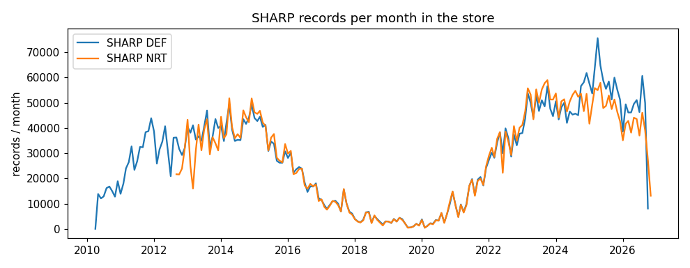
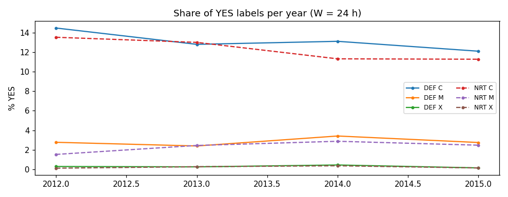

# CORNERSTONE — report della campagna notturna 2026-11-26 (quick)

## 1. Esito in breve

- **Esito complessivo: buono, con un solo fallimento dovuto alla rete.** ✅ 19 pass · ⚠️ 2 warn · ❌ 1 fail · ⏭️ 3 skip (25 test).
- L'unico ❌ è **P3.update**: l'aggiornamento della sorgente `goes` va in `TimeoutError: [Errno 110] Connection timed out`. È la terza esecuzione di fila con questo errore, quindi il problema è di connettività verso NOAA/SWPC e non un difetto nuovo del codice. Il ramo `harp_noaa` invece è stato aggiornato correttamente (3,609 → 3,622 coppie, sulla copia).
- Rispetto a ieri **P6.minirocket è passato da ❌ a ✅**, perché `numba` è ora presente nell'immagine. I due ⚠️ dicono solo che il data store non viene aggiornato da circa 2 settimane.
- La notte si è chiusa **ampiamente in tempo**: test dalle 16:43:42 alle 16:59:13 (≈15.5 min, più 112 s di build), con deadline alle 07:30 del 27/11. `campaign exit code 0`.

## 2. Tabella dei risultati

| | test | durata (min) | numeri chiave |
|---|---|---|---|
| ✅ | P0.env | 0.02 | 12 CPU, 24.6 GB RAM, CUDA no, 43.6 GB liberi |
| ✅ | P2.manifest | 0.01 | 49 file, 652 MB, sha256 tutti verificati |
| ⚠️ | P2.sharp | 0.06 | DEF 5,628,153 righe (ultimo record 50 gg fa); NRT 4,746,570 righe (ultimo record **14 gg** fa) |
| ⚠️ | P2.goes | 0.00 | 33,536 eventi; ultimo evento 2026-11-10 (**15 gg**); 3,609 coppie HARP-NOAA |
| ✅ | P9.validation | 0.14 | 25/25 controlli |
| ✅ | P4.labeling | 0.27 | DEF M 454 YES/16,014; NRT M 340 YES/13,474; ≈2–3 s ciascuno, 0 violazioni |
| ✅ | P4.determinism | 0.10 | 13,474 righe identiche |
| ⏭️ | P4.legacy | 0.00 | `/data/cornerstone.sqlite` assente |
| ✅ | P5.def_xgb | 1.25 | test TSS 24h **0.631**; 8,584 campioni; leakage 0 |
| ✅ | P5.nrt_xgb | 1.05 | test TSS 24h **0.4131**; 4,281 campioni |
| ✅ | P5.def_all22 | 1.85 | 22 feature, test TSS 24h **0.7042** |
| ✅ | P7.reproduce | 0.61 | dataset e metriche identici (diff max 0.0) |
| ✅ | P8.bundle | 0.03 | 6 artifact, 384.5 MB, re-import 6 saltati, import demo rifiutato |
| ✅ | P10.gui_pages | 0.09 | 11 pagine, 0 eccezioni; box di errore atteso in `compare` |
| ✅ | P1.package_tests | 0.08 | 27 test, 0 falliti |
| ✅ | P1.gui_unit | 0.09 | 236 test, 0 falliti |
| ✅ | P1.gui_integration | 2.11 | 7 test, 0 falliti (125.7 s) |
| ✅ | P6.lstm | 2.10 | test TSS 24h 0.4494 (1 epoca, 2 fold) |
| ✅ | P6.inceptiontime | 0.65 | test TSS 24h 0.4329 |
| ✅ | P6.transformer | 1.10 | test TSS 24h 0.561 |
| ✅ | P6.minirocket | 1.55 | test TSS 24h 0.4217 |
| ❌ | P3.update | 2.34 | exit code 1; `goes` in timeout; `harp_noaa` +13 coppie |
| ⏭️ | P6.other_models | 0.00 | non eseguito in modalità quick |
| ⏭️ | P11.inceptiontime_full | 0.00 | non eseguito in modalità quick |
| ✅ | P12.store_unchanged | 0.01 | 49 file invariati |

## 3. Cosa non funziona

### ❌ P3.update — aggiornamento incrementale (sorgenti `harp_noaa,goes`, su una copia dello store)

Righe rilevanti di `logs/P3.update.log`:

```
HARP-NOAA map: 2,648 HARPs, 3,406 NOAA regions, 3,622 pairs
!! goes failed: TimeoutError: [Errno 110] Connection timed out
Update finished in 139s with errors in ['goes']
  File "/opt/cornerstone/cornerstone/data/update.py", line 41, in update_all
    raise RuntimeError("Update failed for: " + "; ".join(f"{k}: {v}" for k, v in errors.items()))
RuntimeError: Update failed for: goes: TimeoutError: [Errno 110] Connection timed out
```

- **Cosa succede:** `harp_noaa` si aggiorna (3,609 → 3,622 righe). Il download GOES invece non riesce ad aprire la connessione (errno 110, a livello TCP). `update_all` raccoglie l'errore e alla fine solleva `RuntimeError` (`/opt/cornerstone/cornerstone/data/update.py:41`, nell'immagine; il sorgente del pacchetto non è presente su questa macchina, quindi non ho potuto vedere né l'URL né il timeout usati per GOES). Il test lo registra come fail in `scripts/nightly/campaign.py:835-836`.
- **Causa probabile:** l'endpoint NOAA/SWPC non è raggiungibile dal container (rete, firewall/proxy oppure servizio giù), non una regressione del codice. Lo stesso errore compare in tutte e tre le esecuzioni disponibili. Il 25/11 l'eccezione era però `URLError: <urlopen error [Errno 110]>` nel run quick e `TimeoutError` nel run completo. Da notare: il 25/11 il timeout arrivava dopo 17.9 min, stanotte dopo 2.3 min. Dai file non si capisce se sia cambiato il timeout lato client o il comportamento della rete.
- **Conseguenza:** finché il ramo `goes` fallisce, il data store reale non riceve nuovi eventi GOES (vedi gli ⚠️ di P2).
- **Come riprodurlo:** `NIGHTLY_ONLY=P3.update scripts/nightly/run.sh --quick`. Oppure direttamente nel container:
  `/opt/venv/bin/python -c "import sys; from cornerstone.data import DataStore; from cornerstone.data.update import update_all; update_all(DataStore(sys.argv[1]), sources=['goes'])" <copia_dello_store>`.
  Conviene anche verificare dal container la raggiungibilità dell'host SWPC usato da `cornerstone.data.update`.

## 4. Criticità e avvertimenti

- **⚠️ P2.sharp — NRT fermo da 14 giorni** (ultimo record 2026-11-11 22:11; la soglia per NRT è 7 gg, `campaign.py:296`). Anche DEF finisce al 2026-10-06 (50 gg, sotto la soglia di 90). Lo store non è stato aggiornato dal 25/11: righe identiche.
- **⚠️ P2.goes — ultimo evento GOES 15 giorni fa** (2026-11-10 20:23; soglia 14 gg, `campaign.py:346`). Ieri il test passava solo perché il ritardo era ancora di 14 giorni: il dato è lo stesso. Collegato al fallimento di P3.
- **TSS NRT molto più bassa di DEF:** P5.nrt_xgb 0.4131 contro 0.631 di P5.def_xgb (−0.22) con la stessa catena. Il dataset NRT ha la metà dei campioni (4,281 contro 8,584) e più NaN (`nan_ratio_overall` 0.318 contro 0.213). Nel run completo del 25/11 NRT arrivava a 0.6721, quindi il divario sembra legato al sottoinsieme ridotto della modalità quick.
- **P5.def_all22 (22 feature) 0.7042 contro 0.631 con le 17 feature "pulite":** il guadagno di +0.07 è consistente e stabile da tre run. Vale la pena capire quali delle 5 feature in più lo producono e se c'è un rischio di leakage.
- **Modelli DL a 1 epoca:** TSS 0.42–0.56, coerenti con un training brevissimo. Per MiniRocket la val TSS CV (0.3815) è più bassa della test (0.4217).
- **Qualità dei dati DEF:** 268,247 record con patch vuota e `LAT_MIN` nullo nel 4.77% dei casi (NRT: 0). GOES: 22 eventi senza picco, 1 evento con satellite `////`. Associazione eventi: in NRT 4,708 eventi non associati contro 1,114 in DEF.
- **P10.gui_pages:** la pagina `compare` mostra un box "comparison NOT valid — the evaluated samples differ…". Nessuna eccezione e messaggio identico da tre run: sembra il comportamento atteso quando si confrontano catene diverse.
- **Disco:** spazio libero 55.7 GB (25/11 quick) → 53.9 GB (25/11 completo) → **43.6 GB** oggi, cioè −12 GB in un giorno. I file non dicono dove sia finito lo spazio (workspace dei run, immagini Docker?). Da tenere d'occhio: P3 in modalità completa richiede almeno 3× la dimensione dello store (`campaign.py:817`).
- Build: warning `Docker Compose is configured to build using Bake, but buildx isn't installed` (innocuo).

## 5. Confronto con le notti precedenti

Run disponibili: `2026-11-25_quick` (stessa configurazione, confronto diretto) e `2026-11-25` (completo: periodo, campioni ed epoche diversi, quindi le TSS non sono confrontabili 1:1).

**Cambi di stato** (rispetto a 2026-11-25_quick):

| test | prima | ora | nota |
|---|---|---|---|
| P6.minirocket | ❌ (`ModuleNotFoundError: numba`) | ✅ | `numba==0.61.2` ora installato nell'immagine |
| P2.goes | ✅ | ⚠️ | stesso dato, il ritardo è passato da 14 a 15 gg e ha superato la soglia |
| P3.update | ❌ | ❌ | invariato (timeout GOES) |

**Metriche:** nessuna TSS cambiata di più di 0.03 rispetto a 2026-11-25_quick: DEF 0.631, NRT 0.4131, all22 0.7042, LSTM 0.4494, InceptionTime 0.4329, Transformer 0.561 sono identiche. Rispetto al run completo i valori differiscono (ad es. NRT 0.6721, all22 0.7962), ma con configurazione diversa.

**Durate:** nessuna è cresciuta di più del 50%. P1.gui_unit è passato da 0.06 a 0.09 min (+50%), ma i test sono saliti da 44 a 236 dopo il cambio di commit della GUI (`8c2362d` → `871c1a2`). Diverse durate sono anzi calate molto: P5.nrt_xgb 11.07 → 1.05 min (split 5.4 → 0.4 min), P5.def_all22 6.81 → 1.85, P3.update 17.92 → 2.34.

## 6. Test saltati

- **P4.legacy:** manca `/data/cornerstone.sqlite` (il database precedente è opzionale e non è presente su questa macchina).
- **P6.other_models** e **P11.inceptiontime_full:** "not run in quick mode". Nessun test è stato saltato per la deadline. Come riferimento, nel run completo del 25/11 P6.other_models era ⚠️ (ROCKET fallito, probabilmente per lo stesso problema di `numba`, ora risolto) e P11 era ⚠️ (test TSS circa 0.07 sotto il riferimento).

## 7. Dati e prestazioni

**Data store** (`/data/datastore`): 49 file, 652 MB, manifest integro e non modificato dai test (P12).

| dataset | righe | HARP | periodo | ritardo |
|---|---|---|---|---|
| sharp/DEF | 5,628,153 | 8,301 | 2010-04-30 → 2026-10-06 | 50 gg |
| sharp/NRT | 4,746,570 | 10,749 | 2012-09-14 → 2026-11-11 | 14 gg |
| goes/swpc_events | 33,536 | – | 2010 → 2026-11-10 | 15 gg |
| harp_noaa | 3,609 coppie | – | – | – |

**Tempi della pipeline (min):**

| catena | labels | dataset | split | train+inferenza | totale test |
|---|---|---|---|---|---|
| P5.def_xgb | 0.1 | 0.1 | 0.5 | 0.6 | 1.25 |
| P5.nrt_xgb | 0.1 | 0.1 | 0.4 | n.d. | 1.05 |
| P5.def_all22 | 0.1 | 0.2 | 0.6 | n.d. | 1.85 |

Labeling di un singolo caso (P4): 2.3–3.0 s. Bundle P8: 1.6 s per 384.5 MB.

**Metriche dei modelli (finestra 24h, M+):**

| modello | dati | CV val TSS | test TSS |
|---|---|---|---|
| XGBoost (17 feature) | DEF | 0.6629 | 0.631 (CV test 0.6081) |
| XGBoost | NRT | n.d. | 0.4131 |
| XGBoost (22 feature) | DEF | n.d. | 0.7042 |
| LSTM (1 ep, 2 fold) | DEF | 0.4823 | 0.4494 |
| InceptionTime (1 ep, 2 fold) | DEF | 0.4884 | 0.4329 |
| Transformer (1 ep, 2 fold) | DEF | 0.5705 | 0.561 |
| MiniRocket (1 ep, 2 fold) | DEF | 0.3815 | 0.4217 |





## 8. Ambiente

- **Package** `cornerstone_db_package`: `984804b6efabe66252da5416c6da0e0d760f4c36` (pulito; invariato rispetto al 25/11).
- **GUI** `cornerstone_gui`: `871c1a2c3917ce7cc7e964bfcf3171c5078347d5` (branch `main`, pulito; il 25/11 era `8c2362d`).
- **Hardware:** 12 CPU, 24.6 GB RAM, CUDA non disponibile (torch `2.9.1+cpu`), 43.6 GB liberi.
- **Software:** Python 3.10.22, numpy 2.2.6, pandas 2.3.3, h5py 3.15.1, scikit-learn 1.7.2, xgboost-cpu 3.1.2, sktime 0.39.0, torch 2.9.1+cpu, clearml 2.0.2.
- **Build dell'immagine** (`build.json`): ok in 112 s, finita alle 2026-11-26T16:43:40Z. Image `cornerstone-gui:latest` (`sha256:764fdf4d…`), 97 pacchetti installati, package preso da `main` di GitHub.
