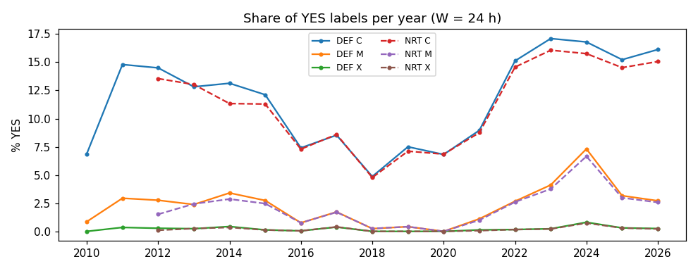

# CORNERSTONE — report della notte 2026-11-27

## 1. Esito in breve

- **Notte buona, nessun fallimento**: ✅ 21 pass · ⚠️ 3 warn · ❌ 0 fail · ⏭️ 1 skip (25 test).
- Il fallimento della notte precedente è risolto: **P3.update** passa con il nuovo commit del package `1b8faac` ("GOES: fall back to urllib…"). L'FTP diretto va ancora in timeout, ma ora il fallback funziona.
- Problema principale: il **data store non è aggiornato** (ultimo record NRT 15 giorni fa, GOES 16 giorni fa, DEF 51 giorni fa). L'update funziona sulla copia, quindi conviene lanciarlo sullo store vero.
- **P11.inceptiontime_full** resta 0,067–0,079 TSS sotto il riferimento, con valori identici da tre notti: lo scarto è sistematico, non è rumore.
- Il run è finito in tempo: 20:00:18 → 23:08:13 (circa 3 h 08 min), con 7 h 22 min di margine sulla deadline delle 06:30. Nessun test è stato saltato per la deadline.

## 2. Tabella dei risultati

| | test | min | valori chiave |
|---|---|---|---|
| ✅ | P0.env | 0.02 | 12 CPU, 24,6 GB RAM, CUDA False, 41,2 GB liberi |
| ✅ | P2.manifest | 0.01 | 49 file, 652 MB, tutti verificati |
| ⚠️ | P2.sharp | 0.05 | DEF 5.628.153 righe (fino al 2026-10-06), NRT 4.746.570 righe (fino al 2026-11-11, 15 giorni fa) |
| ⚠️ | P2.goes | 0.00 | 33.536 eventi, ultimo il 2026-11-10 (16 giorni fa), 3.609 coppie HARP-NOAA |
| ✅ | P9.validation | 0.13 | 25/25 controlli |
| ✅ | P4.labeling | 0.51 | YES M+: DEF 1.541/48.393, NRT 1.323/43.275; 4–6 s per etichettatura |
| ✅ | P4.determinism | 0.19 | identiche (43.275 righe) |
| ⏭️ | P4.legacy | 0.00 | `/data/cornerstone.sqlite` assente |
| ✅ | P5.def_xgb | 2.86 | TSS test 3h 0,594 · 6h 0,596 · 12h 0,581 · 24h 0,579; 21.325 campioni |
| ✅ | P5.nrt_xgb | 6.96 | TSS test 24h 0,672; 17.457 campioni |
| ✅ | P5.def_all22 | 9.32 | 22 feature, TSS test 24h 0,796 |
| ✅ | P7.reproduce | 2.02 | array e metriche identici (diff. max 0,0) |
| ✅ | P8.bundle | 0.07 | 6 artefatti, 962,7 MB, re-import saltato 6/6 |
| ✅ | P10.gui_pages | 0.10 | 11 pagine senza eccezioni; box di errore in `compare` |
| ✅ | P1.package_tests | 0.09 | 30 test, 0 falliti |
| ✅ | P1.gui_unit | 0.09 | 236 test, 0 falliti |
| ✅ | P1.gui_integration | 2.11 | 7 test, 0 falliti (125,6 s) |
| ✅ | P6.lstm | 18.24 | TSS test 24h 0,500 (val 0,606) |
| ✅ | P6.inceptiontime | 2.71 | TSS test 24h 0,506 (val 0,614) |
| ✅ | P6.transformer | 7.77 | TSS test 24h 0,521 (val 0,636) |
| ✅ | P6.minirocket | 2.81 | TSS test 24h 0,272 (val 0,383) |
| ✅ | P3.update | 17.17 | GOES +145, harp_noaa +13, DEF +21.311, NRT +16.020 |
| ✅ | P6.other_models | 14.48 | 11/11 modelli funzionanti |
| ⚠️ | P11.inceptiontime_full | 100.2 | TSS CV test 3h 0,531 · 6h 0,516 · 12h 0,524 · 24h 0,498 (Δ −0,067…−0,079) |
| ✅ | P12.store_unchanged | 0.01 | 49 file invariati |

## 3. Cosa non funziona

Nessun test è in stato `fail` stanotte.

## 4. Criticità e avvertimenti

**Warn**
- **P2.sharp / P2.goes: store vecchio.** Ultimo record NRT il 2026-11-11 22:11 (soglia 7 giorni, `campaign.py:296`). Ultimo evento GOES il 2026-11-10 (soglia 14 giorni, `campaign.py:346`). DEF arriva al 2026-10-06, cioè 51 giorni: sotto la soglia di 90, quindi niente warn. Il P3.update su una copia mostra che i dati nuovi ci sono e si scaricano (+21.311 DEF, +16.020 NRT, +145 eventi GOES). L'azione proposta è aggiornare lo store reale dalla pagina Data o con `update_all`.
- **P11.inceptiontime_full: sotto il riferimento.** Il riferimento è in `campaign.py:52` (`REFERENCE_INCEPTIONTIME_TEST_TSS`, esperimento GUI del 2026-11-12). I delta sono 3h −0,079, 6h −0,072, 12h −0,067, 24h −0,071. Il TSS dell'inferenza sul test è ancora più basso (24h 0,493). I numeri sono identici al decimillesimo nelle notti 25, 26 e 27, quindi il training è deterministico e lo scarto viene dalla configurazione o dai dati, non dal caso. Il riferimento usa "random split" (commento in `campaign.py:50`); la campagna usa `default_split_config` (`campaign.py:514`), e dai file non riesco a stabilire se la strategia coincida. Il training è durato 1,67 h, contro le ~6 h previste dal piano. Con `patience: 20` (`cs_gui/pipeline.py:71`) è probabile un early stopping, ma va verificato. Riproduzione: `NIGHTLY_ONLY=P5.def_xgb,P11.inceptiontime_full scripts/nightly/run.sh`. P11 non gira in `--quick`.

**Cose sospette anche nei test passati**
- **P5.def_all22: TSS 0,796** contro 0,579 delle feature "clean" sullo stesso DEF 24h (+0,217). Il test controlla solo che le feature siano 22 (`campaign.py:630`) e non fa controlli di leakage né confronti. Un salto così grande merita una verifica: qualcuna delle 22 keyword grezze potrebbe portare informazione impropria. Non lo posso stabilire dai file.
- **Ritardo di ~5 minuti che colpisce un passo diverso ogni notte.** Stanotte lo split NRT ha impiegato 5,6 min (0,6 la notte prima), per cui P5.nrt_xgb è passato da 1,95 a 6,96 min. Il 25 era toccato allo split DEF (5,6 min), il 26 a LightTS (5,5 min contro 0,5). Stanotte anche Autoformer è a 5,6 min (0,6 il 26). Lo schema "+5 min su un solo passo" fa pensare a un'attesa o a un timeout nel job runner piuttosto che a calcolo vero. È un'ipotesi.
- **TSS quasi nulli** in P6.other_models (1 epoca, 3h): Autoformer 0,005 e ROCKET 0,037. Con un'epoca ci si aspettano valori bassi, ma questi due sono vicini al caso. Anche MiniRocket è basso nel test breve (0,272).
- **Scarto val→test di XGBoost DEF**: TSS CV val circa 0,667, test circa 0,58 (−0,08). Lo stesso succede ai modelli neurali brevi (val 0,61–0,64 → test 0,50–0,52).
- **P10.gui_pages**:
  - La pagina `compare` mostra il box "Window 24h: comparison NOT valid — the evaluated samples differ; different inference sources; different splits…". Sembra il comportamento voluto, perché nel workspace ci sono run su split diversi.
  - Nel log `logs/P10.gui_pages.log` c'è un traceback non fatale: `pyarrow.lib.ArrowInvalid: Could not convert '["3h", "6h", "12h", "24h"]' with type str: tried to convert to int64 … column trn-20261127-202037-95e9`. Streamlit lo corregge da solo, ma una colonna mescola stringhe e interi. Dalla sequenza dei timestamp la pagina è probabilmente `experiments`, ma non è certo.
- **Qualità dei dati**:
  - DEF ha 268.247 record con patch vuota (LAT_MIN nullo nel 4,77%); NRT ne ha 0.
  - GOES ha 22 eventi senza picco, 1 evento con satellite `////` e 5 con `SDO`.
  - Associazione eventi→HARP: non associati 1.114 su 28.401 in DEF, 4.708 in NRT.
- **Disco**: 41,2 GB liberi, sopra la soglia di 20 GB. Però erano 53,9 GB il 25 e 41,8 GB il 26: −12,7 GB in due notti.

## 5. Confronto con le notti precedenti

Notti complete: 2026-11-25 e 2026-11-26. Esistono anche `2026-11-25_quick` e `2026-11-26_quick`, ma sono in modalità quick (dati ridotti) e non le ho confrontate sulle metriche.

| test | 25 | 26 | 27 | nota |
|---|---|---|---|---|
| P3.update | ❌ | ❌ | ✅ | prima: `RuntimeError: Update failed for: goes: TimeoutError` (`cornerstone/data/update.py:41`); risolto dal fallback urllib di `1b8faac` |
| P6.minirocket | ❌ | ✅ | ✅ | il 25 mancava `numba` |
| P6.other_models | ⚠️ | ✅ | ✅ | il 25 ROCKET falliva (`numba`) |
| P2.goes | ✅ | ⚠️ | ⚠️ | l'evento più recente è sempre del 2026-11-10; ha solo superato la soglia di 14 giorni |

- **Metriche**: nessuna variazione oltre 0,03 TSS. XGBoost DEF/NRT/all22, LSTM, InceptionTime, Transformer e P11 sono identici alla notte del 26. Piccole differenze: MiniRocket 0,2718 → 0,2719 e ROCKET 0,0457 → 0,0368.
- **Durate cresciute di oltre il 50% rispetto al 26**:
  - P5.nrt_xgb: 1,95 → 6,96 min (+257%, è lo split).
  - P5.def_all22: 4,31 → 9,32 min (+116%).
  - P3.update: 10,40 → 17,17 min (+65%). Il 26 però si era fermato per errore, e il 25 aveva impiegato 17,86 min, quindi il valore di stanotte è in linea.
  - Dentro P6.other_models: Autoformer 0,6 → 5,6 min.
- **Suite di test**:
  - package: 27 → 30 test, tempo 17,1 s → 4,3 s;
  - GUI unit: 44 (il 25) → 236 (dal 26).

## 6. Test saltati

- **P4.legacy**: `/data/cornerstone.sqlite` non è presente su questa macchina (il vecchio database è opzionale). È saltato anche nelle notti precedenti. Nessun test è stato saltato per la deadline.

## 7. Dati e prestazioni

**Data store** (`/data/datastore`): 49 file, 652 MB, sha256 verificati, invariato alla fine (P12).

| dataset | righe | HARP | periodo |
|---|---|---|---|
| sharp/DEF | 5.628.153 | 8.301 (max 15222) | 2010-04-30 → 2026-10-06 |
| sharp/NRT | 4.746.570 | 10.749 (max 14198) | 2012-09-14 → 2026-11-11 |
| goes/swpc_events | 33.536 (C 20.647, M 2.760, X 155) | — | 2010 → 2026-11-10 |
| harp_noaa | 3.609 coppie | — | — |

**Tempi della pipeline (min)**

| catena | labels | dataset | split | training+inferenza | totale |
|---|---|---|---|---|---|
| DEF clean (P5.def_xgb) | 0,1 | 0,3 | 0,6 | 1,9 | 2,86 |
| NRT clean (P5.nrt_xgb) | 0,2 | 0,2 | 5,6 | n.d. | 6,96 |
| DEF all (P5.def_all22) | 0,1 | 0,6 | 1,0 | n.d. | 9,32 |
| update JSOC/NOAA (P3) | — | — | — | — | 17,2 (DEF 244 s, NRT 740 s) |

**Metriche dei modelli** (TSS sul test, DEF M+ salvo dove indicato)

| modello | config | 3h | 6h | 12h | 24h |
|---|---|---|---|---|---|
| XGBoost clean | 5 fold | 0,594 | 0,596 | 0,581 | 0,579 |
| XGBoost NRT clean | 5 fold | — | — | — | 0,672 |
| XGBoost all 22 | 5 fold | — | — | — | 0,796 |
| InceptionTime full (CV test) | 5 fold, 100 ep. | 0,531 | 0,516 | 0,524 | 0,498 |
| riferimento InceptionTime | — | 0,610 | 0,588 | 0,590 | 0,569 |
| LSTM / InceptionTime / Transformer / MiniRocket | 5 ep., 2 fold | — | — | — | 0,500 / 0,506 / 0,521 / 0,272 |

Altri modelli (1 epoca, 3h): Informer 0,476, Reformer 0,469, Pyraformer 0,462, TimesNet 0,457, Nonstationary_Transformer 0,443, DLinear 0,368, FEDformer 0,339, ONEFITSALL 0,240, LightTS 0,184, ROCKET 0,037, Autoformer 0,005.

## 8. Ambiente

- **Package** `cornerstone_db_package` `1b8faac` (non dirty). Il log di build riporta `+ 984804b...1b8faac main -> origin/main (forced update)`: `main` è stato riscritto con un force push rispetto al commit delle notti 25–26.
- **GUI** `871c1a2` (main, non dirty), uguale al 26; il 25 era `8c2362d`.
- **Hardware**: Python 3.10.22, 12 CPU, 24,6 GB RAM, CUDA non disponibile (torch 2.9.1+cpu), 41,2 GB liberi.
- **Librerie**: numpy 2.2.6, pandas 2.3.3, scikit-learn 1.7.2, xgboost-cpu 3.1.2, sktime 0.39.0.
- **Build dell'immagine**: ok in 15 s (`build.json`, finita alle 20:00:16 UTC). Unico avviso: "Docker Compose is configured to build using Bake, but buildx isn't installed".
